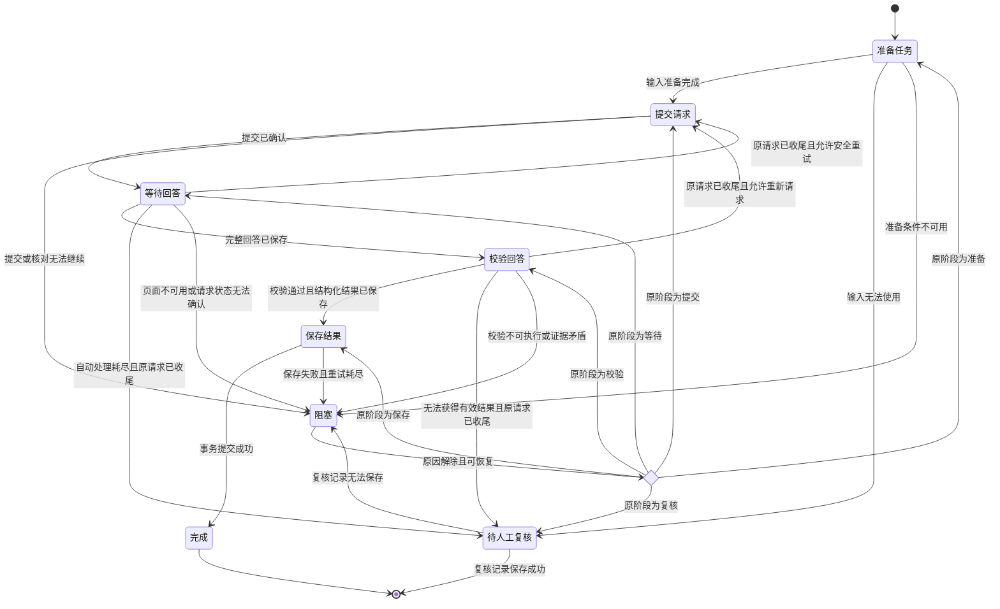

# 小红书分类与提取：任务状态机和等待回答行为树

2026-10-18：设计已确认，尚未实施。本文记录讨论结论，不表示框架适配、生产切换或故障验收已经完成。

## 目标与范围

每个导入任务处理一个视频的一次分类或提取。分类成功且判定为教程后生成提取任务；两种任务共享执行机制，分别提供 prompt、校验规则和保存逻辑。

第一版替换单任务控制逻辑，复用现有浏览器、请求核对、SQLite 和双账号调度能力。协调器只做接入新结果和阻塞范围所必需的适配。分类与提取继续使用独立 worker 和不同访问账号。

优先采用 transitions 管理阶段、事件和转移条件，py_trees 管理等待期间的条件选择及动作生命周期。版本、同步／异步接入和具体代码组织在实施阶段通过适配验证确定。不自建状态机或行为树执行机制，不增加自由编辑树结构或运行中热更新。

相关领域术语见根级 [GLOSSARY.md](../../GLOSSARY.md)，架构取舍见 [ADR 0003](../adr/0003-xhs-task-state-machine-and-answer-tree.md)。

## 职责与控制权

| 所属部分 | 职责 |
|---|---|
| 批量调度 | 分配任务、消费提取队列、响应任务结论及阻塞范围 |
| 任务执行器 | 唯一推进任务阶段，检查转移条件并持久化变化 |
| 等待行为树 | 观察当前请求、选择恢复动作、产生明确等待结果 |
| 浏览器操作 | 页面访问、发送、读取、原会话恢复和历史核对 |
| 请求记录 | 保存提交与回答的事实、身份及证据 |
| 存储 | 原子保存结果、任务完成标记和必要队列变化 |

旧 ChatSession 中决定重试和阶段推进的控制逻辑迁移到新执行器及行为树，不保留两个独立控制者。任务阶段、请求事实、树的等待进度分开记录，例如“任务等待回答／请求已提交／正在延长观察”。

状态机拥有任务阶段的唯一写入权。行为树动作可以保存请求证据和恢复进度，但只能返回业务结果或观察进度，由状态机转移。具体事务接口在适配验证后设计。

## 状态机

| 阶段 | 工作及退出条件 |
|---|---|
| 准备任务 | 确定视频、任务类型、prompt 与请求身份，输入完整合法后推进 |
| 提交请求 | 保存意图、发送并确认；结果不明时留在本阶段核对 |
| 等待回答 | 驱动行为树；完整、归属明确的回答落盘后推进 |
| 校验回答 | 校验归属、结构和业务规则；结构化结果落盘后推进 |
| 保存结果 | 结果、完成标记及必要队列变化原子提交 |
| 完成 | 成功终态 |
| 待人工复核 | 保存自动处理失败结论；复核记录成功保存后才是终态 |
| 阻塞 | 保留原阶段和未解决事项；原因解除并确认可恢复后回到原阶段 |



“恢复位置”是转移判断，不是持久化阶段。暂停是独立运行控制，保留任务阶段，不增加“等待且暂停”等组合状态。

提交结果不明不必增加主状态：提交阶段内部先核对原会话与历史。确认未提交才允许发送；确认已经提交则进入等待。恢复提交阶段也必须遵守此顺序。

重试是阶段转移。任务身份不变，保留旧尝试并创建新请求身份；输入需要重建时才重新准备。保存失败只重试保存已有校验结果，不回到点点发送。

## 等待行为树：全部分支

树只围绕当前请求运行。下列树是业务结构；具体 py_trees 组合节点选型、memory 设置与终止语义须在适配验证中证明符合本文要求。

```text
等待当前请求回答
├─ 顺序：获取观察
│  ├─ 读取任务、请求身份、次数、期限和恢复记录
│  ├─ 读取页面、账号、会话、当前轮及回答
│  └─ 形成带时间的快照：事实／未知／读取错误
└─ 优先选择
   ├─ 身份冲突或证据矛盾
   │  ├─ 检查账号不符、多个匹配、错误回答归属、记录矛盾
   │  ├─ 保存证据与恢复位置
   │  └─ 结束：阻塞
   ├─ 页面不可可靠观察
   │  └─ 选择
   │     ├─ 可见登录或验证要求 → 保存证据 → 阻塞，等待用户处理
   │     ├─ 明确平台限制 → 保存证据 → 阻塞，遵守账号冻结
   │     ├─ 未到恢复时间 → 保留期限 → 运行中
   │     ├─ 到期且还有恢复预算
   │     │  ├─ 保存恢复意图与次数
   │     │  ├─ 恢复页面／原会话
   │     │  └─ 选择
   │     │     ├─ 成功 → 标记需重新关联原请求 → 运行中
   │     │     ├─ 失败但有预算 → 保存证据与退避时间 → 运行中
   │     │     └─ 失败且耗尽 → 进入“耗尽出口”
   │     └─ 恢复预算已经耗尽 → 进入“耗尽出口”
   ├─ 请求尚未可靠关联
   │  ├─ 核对原会话用户消息及历史
   │  └─ 选择
   │     ├─ 唯一匹配 → 保存关联身份 → 运行中，下次观察
   │     ├─ 充分证据确认未提交 → 进入“安全重试判断”
   │     ├─ 核对尚未结束且有预算 → 保存进度 → 运行中
   │     └─ 无法确认且核对耗尽 → 保存证据 → 阻塞
   ├─ 当前请求有非空且已结束的回答
   │  ├─ 确认唯一请求归属与生成结束
   │  └─ 选择
   │     ├─ 尚未稳定 → 保存稳定起始时间 → 运行中
   │     └─ 稳定 → 保存完整原文及身份 → 回答就绪
   ├─ 明确空回答或生成中断
   │  └─ 选择
   │     ├─ 结束状态不确定
   │     │  ├─ 未到最终期限 → 保存部分回答／错误 → 运行中
   │     │  └─ 最终期限到达 → 保存未知事项 → 阻塞
   │     ├─ 已结束但异常尚未稳定 → 保存首次观察时间 → 运行中
   │     └─ 已结束且异常稳定
   │        ├─ 保存证据和部分回答，标记不可作为完整结果
   │        ├─ 标记原尝试已结束且无有效回答
   │        └─ 进入“安全重试判断”
   ├─ 正常等待期限到达
   │  └─ 选择
   │     ├─ 未设置延长观察期限 → 设置一次并保存 → 运行中
   │     ├─ 延长期未到 → 继续观察迟到回答 → 运行中
   │     └─ 延长期到达
   │        ├─ 最后核对原请求
   │        └─ 选择
   │           ├─ 完整且稳定 → 保存回答及身份 → 回答就绪
   │           ├─ 有回答但尚未稳定
   │           │  └─ 有界最终稳定观察
   │           │     ├─ 确认完整 → 保存回答 → 回答就绪
   │           │     ├─ 尚有预算 → 运行中
   │           │     └─ 耗尽且状态不明 → 保存证据 → 阻塞
   │           ├─ 确认未提交或已结束无有效回答 → 安全重试判断
   │           ├─ 明确仍在生成 → 保存证据 → 阻塞，不重发
   │           └─ 无法确定 → 保存证据 → 阻塞
   └─ 其余情况 → 保存必要进度，安排下次检查 → 运行中

安全重试判断（上面的各调用点均使用此完整逻辑）
├─ 原请求未可靠收尾或存在身份矛盾 → 阻塞
├─ 已收尾且请求次数、自动预算与发送策略允许 → 保存原因 → 需要重试
└─ 已收尾但尝试或自动预算耗尽 → 保存汇总 → 需要复核

耗尽出口（页面恢复及总预算共用）
├─ 身份冲突／证据矛盾 → 保存证据 → 阻塞
├─ 请求可能已提交且是否结束不明 → 保存未决身份 → 阻塞
└─ 确认未提交或已结束
   ├─ 已有完整且稳定的回答 → 保存回答 → 回答就绪
   └─ 无有效结果 → 保存汇总 → 需要复核
```

正常回答优先于超时判断；自动预算到达边界时先执行最终核对，受既有访问权限和冻结约束。无法核对则按已保存事实进入阻塞，不能绕过限流访问页面。

生成未结束的文本即使暂时不变也不能当作完整回答。页面不可读不能证明回答为空、请求未提交或用户未登录。可恢复的错页先恢复原会话；明确账号不符、归属冲突或不可消解的证据矛盾才走冲突分支。

### 执行与生命周期

- 每次评估首先重新检查高优先级条件。一次评估只使用一份快照；改变页面的动作完成后，下次重新观察，不使用旧快照继续决策。
- 条件不成立才允许选择下一分支。选中分支内的动作失败必须在该分支收敛为等待、复核或阻塞，不能落入低优先级动作。
- 有副作用的动作只启动一次，后续 tick 推进同一动作。期限首次设置后持久化，不能每次 tick 或重启时延长。
- py_trees 的 update 不执行长时间阻塞等待。心跳、暂停及高优先级观察须保持可响应。
- 分支切换结束本地观察、清理相关资源；本地取消不证明远端生成停止，不构成重发证据。
- 必要回答或证据保存失败时不能返回业务完成结果；进入保存故障处理，最终仍失败则阻塞。

树节点使用 RUNNING／SUCCESS／FAILURE 等框架状态，业务结果独立为“回答就绪／需要重试／需要复核／阻塞”。成功产出任一明确业务结果即可结束本次树运行；SUCCESS 不等于回答成功。结果通过唯一结束出口交付，防止报告阻塞后继续评估其他分支。

| 树结果 | 状态机动作 |
|---|---|
| 运行中 | 保持等待阶段 |
| 回答就绪 | 进入校验 |
| 需要重试 | 再检查安全条件，进入提交 |
| 需要复核 | 进入复核，记录保存成功才结束任务 |
| 阻塞 | 保存原阶段、原因和影响范围 |

## 校验与结果保存

第一版严格校验归属、格式、字段类型、必需字段和可检测的业务矛盾。回答归属冲突阻塞；其他不合格结果保留原文，在原请求结束且有预算时重新请求，耗尽后复核。不自动补全内容，不增加额外纠正对话路径。

结构合法不能证明菜谱忠实、完整，真实验收需要抽样对照视频。Recipe 必需字段沿用术语表定义，具体校验规则按分类与提取分别实现并版本化。

| 检查点 | 持久化内容 |
|---|---|
| 发送前 | 输入、请求身份、意图和相应额度占用 |
| 提交确认 | 会话、用户消息／轮次关联身份 |
| 回答就绪 | 完整原文、来源身份及结束证据 |
| 校验通过 | 结构化结果和校验规则版本 |
| 业务提交 | 结果、完成标记及必要队列变化，同一事务 |

分类判定为教程时，分类结果、分类任务完成和提取入队原子提交。保存通过稳定任务身份幂等执行，退出发生在事务成功与返回之间也不能重复插入或重复入队。

点点与本地数据库没有共同事务：保存意图后发送，结果不明先核对。可能已发出的提交保留额度占用，确认未提交才按既有额度规则结算；不因本地超时释放占用。具体数据库 schema、唯一约束和请求事实字段在实施设计中确定，并通过故障注入验证。

## 预算与时间

| 参数 | 第一版取值／约束 |
|---|---|
| 正常回答等待 | 180 秒 |
| 延长观察 | 600 秒 |
| 每任务点点请求上限 | 2 次 |
| 完整回答稳定确认 | 1 秒，且有结束证据 |
| 空回答稳定确认 | 5 秒，且有结束证据 |
| 页面恢复 | 最多 6 次，第 3 次失败后等待 300 秒 |
| 保存失败重试 | 最多 3 次，短暂退避；耗尽阻塞 |
| 自动处理总预算 | 35 分钟 |

页面恢复、点点请求、保存分别计数。所有自动执行、观察和自动退避受总预算约束，人工等待期间暂停累计。真实回答期限不因人工等待、暂停或重启而重置；恢复后先核对再判断期限。

已保存的回答优先进入校验／保存。预算耗尽时不启动新请求；原请求收尾后可复核，未决则阻塞。限流冻结和每日运行窗口沿用既有策略；发送尚未被允许时保留重试意图，不能把等待发送条件当成“未提交所以立即重发”。

最终稳定观察不能无界延长：受剩余自动预算约束。轮询间隔、页面恢复短退避、保存退避、核对单次期限和框架版本在实施适配中选定，均需有限并记录；这些工程取值不改变已确认的出口和安全规则。

## 阻塞与恢复

| 原因 | 影响范围与恢复 |
|---|---|
| 单请求身份不明 | 当前任务；同 worker 不取下一任务，核对明确后恢复 |
| 登录／验证码 | 对应 worker；用户处理后检测确认再恢复 |
| 页面／网络暂时不可用 | 实际受影响范围；有限退避和自动检查 |
| 账号冻结 | 对应 worker；按冻结策略到期检查，期间不访问 |
| 共享数据库／存储不可用 | 整个批次 |
| 身份冲突、证据矛盾 | 人工解除；无法界定影响或不变量破坏则阻塞整个批次 |

一个 worker 阻塞时，另一 worker 可以继续已有工作。分类阻塞时提取消费既有队列，耗尽后等待分类恢复。预期耗尽且请求已收尾可以持久化复核后继续，不把它当成系统矛盾。

保存原阶段、任务／请求／会话身份、阻塞原因和证据、影响范围、回答与校验结果、次数、期限、自动预算累计值。自动恢复仅用于可验证暂时条件；冲突和矛盾需要人工裁决。

从 SQLite 和请求证据重建框架状态及行为树，不序列化框架实例。恢复使用新的页面快照，延续预算和期限。重启本身不解除阻塞。暂停期间不新增发送，必要的本地持久化与在途事实记录继续按可安全结束的操作处理，具体中断点通过适配验证。

## 观测

关键记录包含任务与请求身份、原阶段与新阶段、触发事件、树分支、依据、次数、剩余预算、下次检查时间、阻塞范围和恢复位置。重复轮询仅在文本、判断或动作变化时记录，心跳独立维护。

原文与诊断证据分别保存并通过引用关联，继续遵守现有脱敏、保留和报告隔离策略。日志必须能解释“为什么仍在等／为什么重试／为什么不能推进”，不能把页面恢复次数与点点发送次数混为一谈。

## 适配验证与实施顺序

1. 验证 transitions 和 py_trees 的同步／异步接入、事件串行、动作终止、非阻塞 tick 与重建方式。失败则调整适配并报告结论，不未经验证定案。
2. 设计并实现任务记录、转移事务、请求事实兼容和幂等保存；迁移旧控制权，保留操作能力。
3. 接入固定等待树、分类／提取校验与阻塞范围，完成模拟故障验收。
4. 使用少量新真实任务验证请求关联、页面证据和提取完整性。
5. 暂停旧执行器、保存任务／请求／节流状态并核对未决请求，再受控切换。

第一版不自动迁移历史未决请求：先由旧逻辑收尾或人工核对。同一任务只能由一个执行器负责，不能并行接管。生产切换是后续独立操作，本设计确认不表示已经授权启动或切换生产任务。

### 验收场景

| 场景 | 必须行为 |
|---|---|
| 发送后确认前退出 | 恢复先核对，不盲目重发 |
| 正常期限到达时有回答 | 优先接收完整回答 |
| 延长期出现迟到回答 | 接收原请求，不创建新请求 |
| 页面多次恢复 | 保留身份，独立计数，不消耗请求额度 |
| 校验失败 | 保存原文，已收尾才重试 |
| 入库成功后返回前退出 | 不重复插入、不重复入队 |
| 单账号登录／冻结 | 对应 worker 阻塞，另一 worker 可继续 |
| 暂停、重启与人工恢复 | 期限和次数不重置，先核对 |
| 请求归属冲突 | 阻塞，不接收、不自动重发 |
| 恢复／总预算耗尽 | 已收尾则复核，未决则阻塞 |
| 保存失败 | 保存重试后阻塞，不重新请求点点 |
| 高优先级分支动作失败 | 分支内处理，不落入低优先级动作 |
| 中断本地等待 | 及时停止本地动作，不推断远端生成结束 |
| 正常分类与提取 | 结果原子完成，教程可靠入队，抽样对照视频 |

## 参考

- [transitions 官方说明](https://github.com/pytransitions/transitions)：状态转移、异步与队列能力；具体使用以实施时锁定版本为准。
- [py_trees 动作生命周期](https://py-trees.readthedocs.io/en/devel/behaviours.html)：初始化、更新、终止与非阻塞要求；实施时核对锁定版本。
- [访问恢复设计](xhs-access-recovery.md)。
- [会话清理与每日运行窗口](xhs-session-cleanup-and-schedule.md)：未决请求及恢复依赖仍阻止清理会话。
